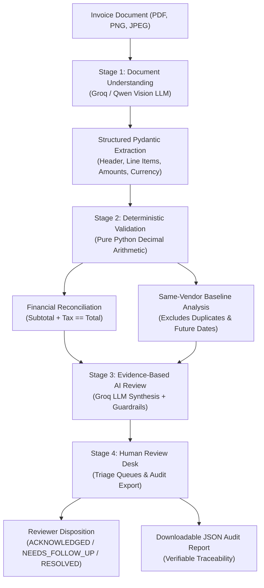
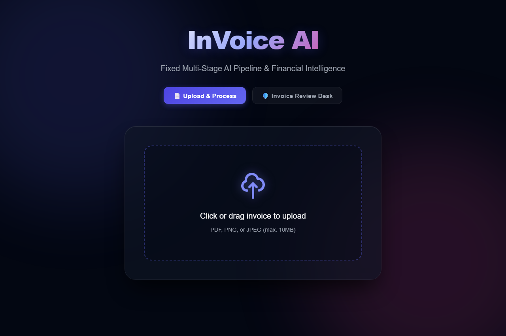
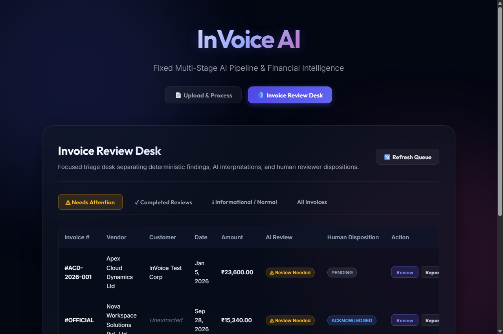
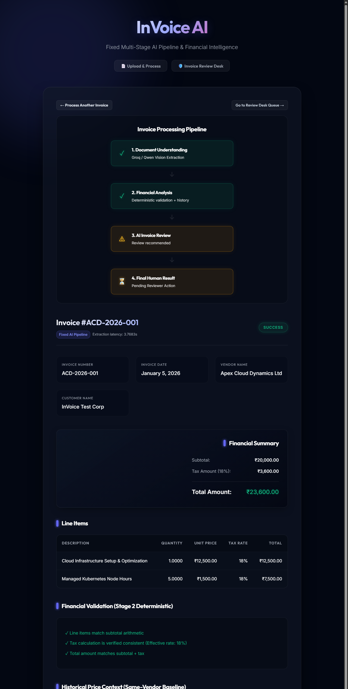
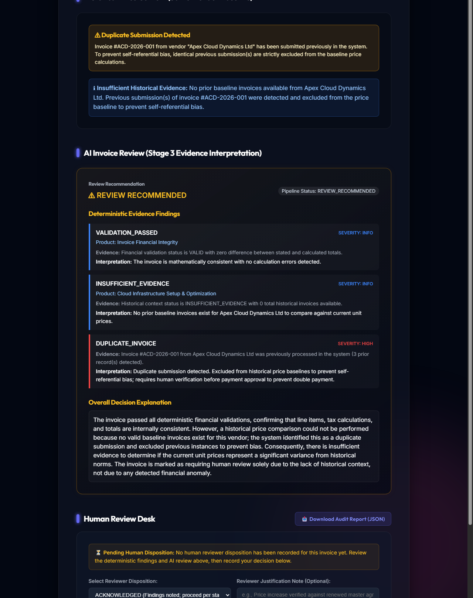

# InVoice AI

> An AI-assisted invoice intelligence and review platform combining vision document extraction, deterministic financial validation, same-vendor historical price baselines, and human-in-the-loop audit workflows.

---

## Project Overview

Accounts payable workflows handle high volumes of variable-format supplier invoices. When organizations attempt to automate invoice processing, they often face two extremes: rigid legacy OCR templates that break when layouts shift, or unconstrained "black box" AI agents that hallucinate arithmetic and make unverified approval decisions.

**InVoice AI explores a hybrid, evidence-based engineering approach**:
* **Probabilistic AI for Document Perception**: High-parameter vision LLMs extract unstructured header data, line items, and tax rates across arbitrary visual layouts without manual coordinate templating.
* **Deterministic Code for Mathematical Truth**: Extracted figures are handed off to pure Python `Decimal` arithmetic for subtotal, tax, and line-item reconciliation, alongside same-vendor historical price baseline tracking.
* **Evidence-Bound Synthesis**: The review model is prompted exclusively with verified arithmetic findings to produce objective operational summaries without speculative fraud accusations.
* **Human-in-the-Loop Authority**: Discrepancies and price creep are surfaced to an interactive Review Desk where authorized reviewers record formal dispositions and export standardized audit reports.

---

## Where InVoice Fits: AI Pipelines vs. Agentic AI

InVoice AI is the **fixed-pipeline track of a broader exploration into AI pipelines versus genuinely agentic systems**.

The goal is to understand not just how to integrate AI into an application, but also how the way an AI system is orchestrated affects its behavior, control, and reliability.

InVoice follows a developer-defined sequence of stages:

**Document Understanding → Deterministic Analysis → AI Review → Human Decision**

Each stage has a defined responsibility, and the application controls the order in which the stages execute. LLMs handle document understanding and evidence interpretation, while deterministic application code performs financial validation and manages the workflow.

This is intentional. InVoice is not designed to be an autonomous agent that independently chooses its next actions or replans its workflow. Instead, it provides a practical example of a structured AI pipeline with explicit boundaries, verifiable calculations, and human oversight.

A separate companion project explores the agentic approach, where a system works toward a goal by selecting tools and actions, observing results, and adapting its next steps within defined constraints.

Together, these projects provide a practical learning opportunity to examine the difference between **AI used within a predefined workflow** and **AI that dynamically determines how to pursue a goal**. The focus is on understanding the architectural trade-offs, not claiming that one approach is universally better than the other.

---

## Problem Statement

Accounts payable teams processing recurring supplier invoices face recurring operational challenges:
1. **Unnoticed Price Creep**: Suppliers incrementally raising unit prices on catalog items above historical agreements.
2. **Mathematical Discrepancies**: Subtle mismatches between line totals, calculated tax rates, and stated invoice totals.
3. **Duplicate Billing Risks**: Inadvertent re-processing of previously submitted invoice numbers from the same vendor.
4. **Lack of Auditability**: Automated systems approving disbursements without verifiable, explainable calculation logs.

---

## The Fixed Multi-Stage Pipeline



### Stage Responsibilities
| Stage | Component | Responsibility |
|---|---|---|
| **1. Document Understanding** | Groq Vision API (`qwen/qwen3.8-27b`) | Extracts vendor, customer, line items, quantities, and totals into an `InvoiceExtractionSchema`. |
| **2. Deterministic Analysis** | Pure Python (`Decimal`) | Validates arithmetic (`Qty * Price == Total`, `Subtotal + Tax == Total`) and builds same-vendor price baselines. |
| **3. Evidence-Based Review** | Groq API (`qwen/qwen3.8-27b`) + Guardrails | Synthesizes verified findings into objective operational explanations without asserting fraud. |
| **4. Human Review Desk** | React 19 UI + FastAPI | Organizes invoices into triage queues, captures human reviewer dispositions, and exports audit records. |

---

## Key Engineering Decisions

* **AI for Perception, Deterministic Code for Math**: LLMs extract visual information and summarize narrative findings, but they never calculate numbers. All arithmetic reconciliation is executed in pure Python using `Decimal` with explicit rounding tolerances (`MONETARY_TOLERANCE = 0.05`).
* **Self-Referential Duplicate Exclusion**: When an invoice number is submitted multiple times, identical prior submissions are excluded from historical baseline pricing to prevent skewing historical averages.
* **Informational Price Decreases**: Vendor price cuts are categorized as informational (`LOW` severity), keeping reviewer attention focused on unapproved price increases.
* **Honest Missing History**: When processing first-time vendors, the system reports `INSUFFICIENT_EVIDENCE` rather than manufacturing speculative price baselines or flagging missing history as suspicious.
* **Zero-Dependency Native Routing**: Frontend navigation between `#upload`, `#review`, and `#invoice-{id}` uses native browser hash history (`window.onhashchange`), providing Back/Forward support without extra router libraries.

---

## Technology Stack

* **Frontend**: React 19, Vite, Vanilla CSS (custom glassmorphic theme). Component hierarchy and UI workflow in [`frontend/README.md`](frontend/README.md).
* **Backend**: Python 3.11+, FastAPI, SQLAlchemy 2.0, Alembic, Pydantic v2, PyMuPDF. Detailed schema and endpoint documentation in [`backend/README.md`](backend/README.md).
* **Database**: PostgreSQL 14+ with relational models and JSON audit fields.
* **AI & Document Understanding**: Groq Cloud SDK (`groq-python`) leveraging vision models (`qwen/qwen3.8-27b`).
* **Research & Evaluation Suite**: Candidate benchmarking scripts and exploratory evaluation data in [`backend/evaluation/README.md`](backend/evaluation/README.md).

---

## Local Setup & Quickstart (Windows)

### Prerequisites
* Python 3.11 or 3.12, Node.js 18+, PostgreSQL 14+, and a [Groq API Key](https://console.groq.com/).

### 1. Clone & Configure Database
```powershell
git clone https://github.com/SatwikReddyP08/invoice-ai.git
cd invoice-ai

# In PostgreSQL (psql / pgAdmin):
# CREATE USER invoice_app WITH PASSWORD 'your_password';
# CREATE DATABASE invoice_db OWNER invoice_app;
# GRANT ALL PRIVILEGES ON DATABASE invoice_db TO invoice_app;
```

### 2. Backend Setup
```powershell
cd backend
python -m venv .venv
.\.venv\Scripts\Activate.ps1
python -m pip install --upgrade pip
pip install -r requirements.txt
Copy-Item .env.example .env
# Edit .env: Set POSTGRES_PASSWORD and GROQ_API_KEY
alembic upgrade head
```

### 3. Frontend Setup
In a separate terminal:
```powershell
cd frontend
npm install
```

### 4. Run Development Servers
* **Backend** (from `backend/`):
  ```powershell
  uvicorn app.main:app --reload --port 8000
  ```
  API Docs: `http://localhost:8000/docs`
* **Frontend** (from `frontend/`):
  ```powershell
  npm run dev
  ```
  Application UI: `http://localhost:5173`

---

## Review Desk Workflow & Audit Export

The **Invoice Review Desk** organizes processed documents into dedicated operational triage queues:
* **⚠ Needs Attention**: Invoices with arithmetic discrepancies, duplicate submissions, or significant unit-price increases (>10%).
* **✓ Completed Reviews**: Invoices where a reviewer has recorded an operational disposition (`ACKNOWLEDGED`, `NEEDS_FOLLOW_UP`, or `RESOLVED`).
* **ℹ Informational / Normal**: Invoices mathematically verified with no actionable variances or baseline exceptions.
* **All Invoices**: Master ledger of all processed documents.

### Invoice Inspection & Human Disposition
When an invoice is uploaded from `#upload` or selected from the Review Desk (`#review`), the application navigates to its generated invoice view (`#invoice-{id}`). Reviewers can:
1. **Inspect Extraction & Arithmetic**: Review extracted line items, subtotal, tax rate, and the independent mathematical balance check.
2. **Evaluate Historical Price Baselines**: Examine unit price shifts compared to prior submissions from the same vendor.
3. **Record Reviewer Disposition**: Select from available operational dispositions:
   * `ACKNOWLEDGED`: Findings noted; proceed per standard accounts payable workflow.
   * `NEEDS_FOLLOW_UP`: Requires vendor or procurement clarification.
   * `RESOLVED`: Exception verified, approved, and cleared.
   Reviewers can enter an optional note and click **Record Human Disposition**. Dispositions can be updated as review progresses; they are not locked or cryptographically immutable.
4. **Export Standardized Audit Reports**: From the Review Desk table, clicking **📥 Report (JSON)** exports a verifiable audit report reconciling extraction provenance, mathematical validation, historical price comparisons, AI findings, and human disposition.

> **Note on Duplicate Ingestion & Sample Testing**:
> If a test invoice is submitted more than once (such as reference sample `ACD-2026-001`), InVoice AI legitimately detects and flags it as a duplicate submission. This is intended behavior to prevent duplicate payments. Identical re-submissions are excluded from baseline calculations to prevent distorting rolling price statistics.

### Synthetic Audit Report Sample
An illustrative synthetic audit record is provided in [`docs/sample_audit_report.json`](docs/sample_audit_report.json):

```json
{
  "report_title": "InVoice AI Audit & Review Report - #SYNTH-INV-2026-0842 (Synthetic Illustrative Example)",
  "invoice_summary": {
    "invoice_number": "SYNTH-INV-2026-0842",
    "vendor_name": "Northwest Office Solutions LLC (Synthetic)",
    "subtotal": 1200.0,
    "tax_amount": 96.0,
    "total_amount": 1296.0,
    "currency": "USD"
  },
  "financial_validation": { "total_consistent": true, "calculated_total": 1296.0, "difference": 0.0 },
  "historical_price_analysis": {
    "comparisons": [{
      "product": "Ergonomic Lumbar Task Chair",
      "current_unit_price": 450.0,
      "latest_previous_unit_price": 400.0,
      "percentage_change_from_previous": 12.5,
      "change_category": "SIGNIFICANT_INCREASE"
    }]
  },
  "ai_review": {
    "review_recommendation": "REVIEW_RECOMMENDED",
    "findings": [{ "type": "PRICE_CHANGE", "severity": "MEDIUM", "product": "Ergonomic Lumbar Task Chair" }]
  },
  "human_reviewer_disposition": {
    "disposition": "RESOLVED",
    "notes": "Demonstration review note: Unit price variance reviewed and accepted for illustrative testing."
  }
}
```

---

## Application Walkthrough & Screenshots

### 1. Document Upload & Ingestion
The landing view provides an intuitive drag-and-drop interface supporting commercial invoice formats (PDF, PNG, JPEG up to 10 MB).



---

### 2. Invoice Review Desk (Operational Triage Queues)
The Review Desk organizes processed documents into dedicated operational queues (`⚠ Needs Attention`, `✓ Completed Reviews`, `ℹ Informational / Normal`, and `All Invoices`), displaying extracted amounts, AI recommendations, reviewer status, and report export actions.



---

### 3. Multi-Stage Pipeline & Extraction Validation
The inspection view displays real-time status across all four pipeline stages, extracted header fields, financial summary cards, and itemized line items with independent arithmetic reconciliation.



---

### 4. Baseline Analysis, AI Findings & Human Disposition Desk
The lower section surfaces duplicate invoice alerts, same-vendor historical baseline comparisons, deterministic evidence findings with natural-language synthesis, and the human reviewer disposition desk with downloadable JSON audit reports.



---

## Key Learnings

Developing InVoice AI provided practical experience with structured AI pipelines, deterministic validation, and human-in-the-loop system design. It also establishes the pipeline side of a broader exploration into how predefined AI workflows differ from systems that dynamically plan and select actions.

* **Strict Boundary Separation (Perception vs. Computation)**: Generative models excel at extracting semantics from arbitrary visual layouts, but fail unpredictably at basic arithmetic. Enforcing a strict architectural boundary—where the LLM produces structured data and deterministic code computes all totals—guarantees mathematical consistency while retaining layout flexibility.
* **Eliminating Baseline Contamination**: Historical baselines must exclude identical re-submissions. If a duplicate invoice is ingested into the comparison pool, it dilutes variance thresholds and obscures genuine price creep. Isolating baselines to same-vendor, prior-dated records protects audit integrity.
* **Document AI Practicalities**: Benchmarking revealed that high-capacity multimodal vision LLMs offer rapid adaptability across diverse invoice templates compared to rigid coordinate-based OCR or fine-tuned token-classification models (LayoutLMv3/Donut), which struggle when supplier formatting deviates from training distributions.
* **Human-in-the-Loop Workflow Design**: AI should assist and explain, not autonomously authorize financial disbursements. Building an actionable triage desk with auditable dispositions (`ACKNOWLEDGED`, `NEEDS_FOLLOW_UP`, `RESOLVED`) creates accountable human oversight.

---

## Future Direction

* **Multi-Page Document Chunking**: Extending the PyMuPDF preprocessing pipeline to handle complex multi-page statements and batch invoice packets.
* **Role-Based Access Control (RBAC)**: Introducing tiered permissions for AP clerks, finance managers, and compliance auditors.
* **Purchase Order Matching**: Two-way and three-way PO reconciliation against enterprise ERP databases.
* **Cryptographic Audit Signing**: Attaching tamper-evident digital signatures to exported JSON audit reports.

---

## Limitations & Project Scope

* **Engineering Portfolio Scope**: InVoice AI is a portfolio project and proof-of-concept demonstrating practical AI integration and pipeline architecture. It has not undergone enterprise compliance certification or third-party penetration testing.
* **Human-in-the-Loop Authority**: InVoice AI assists accounts payable review; it does not autonomously authorize disbursements or interface directly with banking networks. Dispositions are recorded with timestamps and reviewer notes, but are not cryptographically immutable.
* **Historical Baseline Requirements**: Price comparisons require prior invoices from the same vendor with matching currency and earlier dates.
* **Input Validation**: Documents are restricted to 10 MB and checked for basic image/PDF magic bytes (`filetype`). Real-world deployments require additional malware scanning and tenant isolation.
* **Evaluation Scope**: Exploratory benchmarks in `backend/evaluation/` reflect a 10-document reference set used to compare model architectures; they are not generalized accuracy guarantees across arbitrary global invoice formats.

---

## 👨‍💻 Author

**Satwik Reddy Pathapati**
* GitHub: [@SatwikReddyP08](https://github.com/SatwikReddyP08)
* Repository: [https://github.com/SatwikReddyP08/invoice-ai](https://github.com/SatwikReddyP08/invoice-ai)

If you find this project or its engineering approach interesting, feel free to explore the repository, try the local setup, or connect with me for feedback and discussions.
