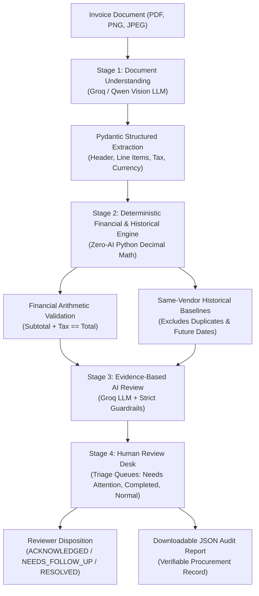

# InVoice AI

**Intelligent Multi-Stage Invoice Processing, Historical Price Analysis & Audit Desk**

InVoice AI is a full-stack document intelligence application engineered for accounts payable, procurement, and financial audit teams. Rather than relying on unpredictable autonomous agents, InVoice AI operates as a **strictly bounded, fixed multi-stage pipeline** combining multi-modal document understanding, deterministic financial arithmetic, same-vendor historical baselines, evidence-based AI review, and a dedicated human review desk.

---

## Table of Contents

1. [Product Overview & Key Features](#1-product-overview--key-features)
2. [The Fixed Multi-Stage Pipeline](#2-the-fixed-multi-stage-pipeline)
3. [Invoice Lifecycle: How One Document Moves Through the System](#3-invoice-lifecycle-how-one-document-moves-through-the-system)
4. [Technology Stack](#4-technology-stack)
5. [Key Architecture & Engineering Decisions](#5-key-architecture--engineering-decisions)
6. [Prerequisites & Environment Configuration](#6-prerequisites--environment-configuration)
7. [Local Setup & Startup Guide (Windows)](#7-local-setup--startup-guide-windows)
8. [Core API Endpoints Reference](#8-core-api-endpoints-reference)
9. [Focused Invoice Review Desk](#9-focused-invoice-review-desk)
10. [Audit Report Export (JSON)](#10-audit-report-export-json)
11. [Research & Document AI Benchmarking](#11-research--document-ai-benchmarking)
12. [Security Considerations](#12-security-considerations)
13. [Limitations & Responsible-Use Notes](#13-limitations--responsible-use-notes)
14. [Demo Walkthrough Script (45–90 Seconds)](#14-demo-walkthrough-script-4590-seconds)
15. [Manual Verification Walkthrough](#15-manual-verification-walkthrough)
16. [Troubleshooting](#16-troubleshooting)

---

## 1. Product Overview & Key Features

Accounts payable teams regularly process hundreds of supplier invoices, exposing organizations to costly operational risks:
1. **Mathematical Discrepancies**: Inconsistent line totals, incorrect tax computations, or subtotal mismatches.
2. **Unnoticed Price Creep**: Suppliers incrementally raising unit prices on recurring catalog products above historical contract rates.
3. **Duplicate Billing**: Inadvertent double-payment of previously submitted invoice numbers from the same vendor.

InVoice AI addresses these challenges through a unified, reproducible four-stage workflow:

* **Visual Document Understanding**: High-fidelity data extraction using Groq Cloud Vision (`qwen/qwen3.8-27b`) into a validated Pydantic schema, accurately handling rotated layouts, discounts, multi-page tables, and currencies.
* **Deterministic Financial Arithmetic**: Pure Python monetary math (`Decimal`) validating that line totals sum to subtotal and subtotal plus tax equals total amount, with zero reliance on LLMs for calculations.
* **Same-Vendor Historical Price Baselines**: Identifies previous invoices from the same vendor and strictly prior dates, evaluating current unit prices against historical averages with percentage variances and IQR outlier filtering.
* **Evidence-Based AI Review**: A dedicated second LLM pass that synthesizes verified arithmetic and historical findings into procurement explanations, operating under guardrails that neutralize unprovable fraud allegations.
* **Human Review Desk**: Triage queues (`Needs Attention`, `Completed Reviews`, `Informational / Normal`, `All Invoices`) enabling human reviewers to log formal dispositions (`ACKNOWLEDGED`, `NEEDS_FOLLOW_UP`, `RESOLVED`) and export comprehensive JSON audit reports.

---

## 2. The Fixed Multi-Stage Pipeline

InVoice AI enforces an architectural boundary: **AI models read documents and interpret evidence; deterministic Python code computes mathematics and validates business rules.**



### Stage Responsibilities
| Stage | Engine | Responsibility |
|---|---|---|
| **Stage 1: Document Understanding** | Groq / Qwen Vision | Extracts vendor, customer, dates, currency, line items, and financial totals into a validated Pydantic schema. |
| **Stage 2: Deterministic Analysis** | Pure Python (`Decimal`) | Verifies internal arithmetic and compares current unit prices strictly against prior invoices from the same vendor. |
| **Stage 3: Evidence-Based AI Review** | Groq API + Guardrails | Synthesizes findings into explainable procurement notes without hallucinating facts or asserting fraud. |
| **Stage 4: Invoice Review Desk** | FastAPI + React UI | Allows human reviewers to triage exceptions, log dispositions with notes, and download comprehensive audit summaries. |

---

## 3. Invoice Lifecycle: How One Document Moves Through the System

Every invoice submitted to InVoice AI follows a predictable, non-agentic lifecycle:

1. **Document Upload (`POST /api/v1/invoices/upload`)**:
   - The file (PDF, PNG, or JPEG up to 10 MB) is validated via binary magic bytes (`filetype`) to prevent malicious executable execution.
   - The document is assigned a unique storage path and an initial database record with status `PENDING`.
2. **Stage 1 — Vision Extraction (`POST /api/v1/invoices/{id}/extract`)**:
   - For PDFs, PyMuPDF renders pages into high-resolution PNG images.
   - Groq Cloud Vision (`qwen/qwen3.8-27b`) analyzes visual layout and text, extracting headers, line items, quantities, unit prices, and amounts into an `InvoiceExtractionSchema`.
3. **Stage 2 — Deterministic Analysis**:
   - **Financial Arithmetic Engine**: Computes line item totals, establishes effective tax rate, and verifies `Subtotal + Tax == Total` using `Decimal` arithmetic with explicit rounding tolerances (`MONETARY_TOLERANCE = 0.05`).
   - **Historical Price Engine**: Queries the database for prior invoices from the **same vendor**, with **strictly earlier invoice dates** and **matching currency**. Excludes identical previous submissions to prevent self-referential bias. Computes percentage change from latest previous price and historical mean.
4. **Stage 3 — Evidence-Based AI Review**:
   - The second LLM call receives structured deterministic evidence (facts only).
   - Generates findings and recommendations (`REVIEW_RECOMMENDED`, `NO_ACTION_REQUIRED`, or `INSUFFICIENT_DATA`).
   - Post-validation guardrails enforce that price decreases are classified as informational (`LOW` severity), duplicate submissions are flagged authoritatively, and missing history is never labeled as fraud.
5. **Stage 4 — Human Review Desk & Disposition**:
   - The invoice appears in the Review Desk under the appropriate triage queue.
   - Reviewer inspects line items, arithmetic proofs, historical comparisons, and AI findings.
   - Reviewer records a formal disposition (`ACKNOWLEDGED`, `NEEDS_FOLLOW_UP`, `RESOLVED`) with justification notes.
   - Full audit trail is exportable as a standardized JSON audit report.

---

## 4. Technology Stack

* **Backend & API**:
  * **Python 3.11+**: Core backend runtime.
  * **FastAPI 0.141+**: High-performance asynchronous REST API framework with automatic OpenAPI documentation.
  * **SQLAlchemy 2.0**: Type-safe ORM utilizing parameterized SQL queries.
  * **Alembic**: Database schema migration management.
  * **Pydantic v2**: Strict schema validation and serialization.
  * **PyMuPDF (fitz)**: Ultra-fast document rasterization.
* **Frontend**:
  * **React (18 / 19)**: Single-page application component architecture.
  * **Vite**: Modern lightning-fast HMR frontend tooling.
  * **Vanilla CSS**: Custom dark-mode glassmorphic design system with zero external UI framework dependencies.
* **Database**:
  * **PostgreSQL 14+**: Relational storage with JSON document audit fields.
* **AI & Document Intelligence**:
  * **Groq Cloud SDK (`groq-python`)**: High-throughput inference for multi-modal vision models (`qwen/qwen3.8-27b`).
* **Research & Benchmarking Suite**:
  * Isolated benchmark suite in `backend/evaluation/` comparing multi-modal vision LLMs against Document AI candidates (LayoutLMv3, Donut, PyMuPDF spatial parser).

---

## 5. Key Architecture & Engineering Decisions

1. **Separation of Probabilistic AI and Deterministic Mathematics**:
   LLMs are probabilistic pattern recognizers prone to arithmetic hallucinations. In InVoice AI, LLMs are strictly restricted to reading unstructured documents (Stage 1) and synthesizing narrative explanations (Stage 3). All math (`Quantity * Price == Line Total`, `Subtotal + Tax == Total`) is computed in pure Python using `Decimal`.
2. **Exclusion of Duplicate Invoices from Historical Baselines**:
   When an invoice number is submitted multiple times, previous submissions of that same invoice number are strictly excluded from historical baseline pricing. Including identical previous submissions would artificially skew historical averages and mask price creep.
3. **Informational Treatment of Unit-Price Decreases**:
   Suppliers lowering unit prices does not represent procurement fraud or cost escalation. InVoice AI policy classifies price drops as informational (`LOW` severity), preventing alert fatigue and keeping reviewer focus on unapproved price increases.
4. **Honest Handling of Missing History**:
   When an invoice is received from a new vendor with no prior billing records, the system reports `INSUFFICIENT_EVIDENCE`. It never manufactures baseline comparisons or flags the absence of history as suspicious.
5. **Zero-Dependency Native Hash Routing**:
   Frontend navigation (`#upload`, `#review`, `#invoice-{id}`) is managed via native browser hash listeners (`window.onhashchange`), providing browser Back/Forward button history without introducing bulky third-party router libraries.

---

## 6. Prerequisites & Environment Configuration

### Prerequisites
* **Python**: Version 3.11 or 3.12 (with `pip` and `venv`).
* **Node.js**: Version 18.x or 20.x (with `npm`).
* **PostgreSQL**: Version 14 or higher running on port 5432.
* **Groq API Key**: A valid API key from [Groq Cloud](https://console.groq.com/).

### Environment Variables (`backend/.env`)
Copy `backend/.env.example` to `backend/.env` and provide your credentials:

```ini
PROJECT_NAME="InVoice AI"
API_V1_STR="/api/v1"

# PostgreSQL Configuration
POSTGRES_SERVER=localhost
POSTGRES_USER=invoice_app
POSTGRES_PASSWORD=your_postgres_password_here
POSTGRES_DB=invoice_db
POSTGRES_PORT=5432

# Groq Vision API Configuration
GROQ_API_KEY=your_groq_api_key_here
GROQ_MODEL=qwen/qwen3.8-27b

# Deterministic Analysis Policy Thresholds
PRICE_CHANGE_THRESHOLD_PERCENT=10.0
PRICE_CHANGE_MATERIAL_PERCENT=25.0
MONETARY_TOLERANCE=0.05
```

---

## 7. Local Setup & Startup Guide (Windows)

### Step 1: Clone Repository
```powershell
git clone https://github.com/SatwikReddyP08/invoice-ai.git
cd invoice-ai/InVoice
```

### Step 2: Configure PostgreSQL Database
In PostgreSQL (`psql` or pgAdmin), create the database user and database:
```sql
CREATE USER invoice_app WITH PASSWORD 'your_secure_password';
CREATE DATABASE invoice_db OWNER invoice_app;
GRANT ALL PRIVILEGES ON DATABASE invoice_db TO invoice_app;
```

### Step 3: Setup Backend
```powershell
cd backend
python -m venv .venv
.\.venv\Scripts\Activate.ps1
python -m pip install --upgrade pip
pip install -r requirements.txt
Copy-Item .env.example .env
# Edit .env with your PostgreSQL password and Groq API key
alembic upgrade head
```

### Step 4: Setup Frontend
In a separate terminal:
```powershell
cd frontend
npm install
```

### Step 5: Start Development Servers

* **Terminal 1 (Backend)**:
  ```powershell
  cd backend
  .\.venv\Scripts\Activate.ps1
  uvicorn app.main:app --reload --port 8000
  ```
  API Docs: `http://localhost:8000/docs`

* **Terminal 2 (Frontend)**:
  ```powershell
  cd frontend
  npm run dev
  ```
  Application UI: `http://localhost:5173`

---

## 8. Core API Endpoints Reference

All endpoints are prefixed with `/api/v1/invoices`:

| Method | Endpoint | Description |
|---|---|---|
| `POST` | `/upload` | Uploads PDF, PNG, or JPEG invoice file and creates initial database record. |
| `POST` | `/{id}/extract` | Executes the complete multi-stage AI pipeline on the invoice. |
| `GET` | `/` | Queries invoices with queue filter (`all`, `needs_attention`, `completed`, `informational`). |
| `GET` | `/{id}` | Retrieves full invoice details, line items, financial validation, and AI review. |
| `POST` | `/{id}/disposition` | Records human reviewer decision (`ACKNOWLEDGED`, `NEEDS_FOLLOW_UP`, `RESOLVED`) and notes. |
| `GET` | `/{id}/report` | Generates a comprehensive JSON audit report for procurement compliance. |
| `DELETE` | `/{id}` | Deletes an invoice record and associated line items. |

For detailed schema definitions, refer to [`backend/README.md`](backend/README.md) or visit the interactive Swagger UI at `http://localhost:8000/docs`.

---

## 9. Focused Invoice Review Desk

The Review Desk provides a clear triage workflow separating automated findings from human business judgments:

* **Needs Attention Queue**: Invoices flagged by the deterministic engine or AI review (arithmetic discrepancy, duplicate invoice submission, or material unit-price increase).
* **Completed Reviews Queue**: Invoices where an authorized reviewer has recorded a formal disposition.
* **Informational / Normal Queue**: Invoices verified mathematically consistent with no action required, or where price decreases are cataloged as informational per company policy.
* **All Invoices Queue**: Master ledger of all processed documents.

### Reviewer Dispositions
* `ACKNOWLEDGED`: Findings and minor variances noted; approved to proceed through standard AP workflow.
* `NEEDS_FOLLOW_UP`: Discrepancy or unapproved price increase flagged; requires clarification from supplier or procurement.
* `RESOLVED`: Exception investigated, verified (e.g. renewed annual master services agreement), and cleared.

---

## 10. Audit Report Export (JSON)

InVoice AI provides a single-click downloadable JSON audit report containing all extraction metadata, mathematical proofs, historical baseline comparisons, AI findings, and the reviewer disposition.

A complete sample report is available in [`docs/sample_audit_report.json`](docs/sample_audit_report.json):

```json
{
  "report_title": "InVoice AI Audit & Review Report - #ACD-2026-001",
  "invoice_summary": {
    "invoice_number": "ACD-2026-001",
    "vendor_name": "Nova Workspace Solutions",
    "subtotal": 20000.0,
    "tax_amount": 3600.0,
    "total_amount": 23600.0,
    "currency": "INR"
  },
  "financial_validation": {
    "total_consistent": true,
    "calculated_total": 23600.0,
    "difference": 0.0
  },
  "historical_price_analysis": {
    "is_duplicate_invoice": true,
    "status": "INSUFFICIENT_EVIDENCE"
  },
  "ai_review": {
    "review_recommendation": "REVIEW_RECOMMENDED",
    "findings": [
      {
        "type": "DUPLICATE_INVOICE",
        "severity": "HIGH",
        "explanation": "Duplicate submission detected. Excluded from historical price baselines..."
      }
    ]
  },
  "human_reviewer_disposition": {
    "disposition": "RESOLVED",
    "notes": "Verified against renewed contract master pricing."
  }
}
```

---

## 11. Research & Document AI Benchmarking

In addition to the production application, InVoice AI includes a research suite benchmarking alternative document understanding models against ground-truth invoice datasets.

Candidate models evaluated include:
* **Groq / Qwen Vision (`qwen/qwen3.8-27b`)** *(Production Primary)*: 100% header field accuracy and 90% full table extraction on reference test set.
* **LayoutLMv3 (`layoutlmv3-finetuned-invoice`)**: Token-classification encoder; fragmented multi-line addresses and struggled with table column association.
* **Donut (`invoices-donut-model-v1`)**: OCR-free generative model; prone to line item count hallucinations and multi-page truncation.
* **PyMuPDF Deterministic Spatial Parser**: Rule-based coordinate clustering; ultra-fast (0.08s) on digital text, but unsupported on scanned raster images.

For full benchmarking methodology, quantitative metrics, and reproducible scripts, see [`backend/evaluation/README.md`](backend/evaluation/README.md).

---

## 12. Security Considerations

* **MIME & Magic Byte Inspection**: Uploaded documents are verified using `filetype` binary magic byte inspection, rejecting renamed executable binaries or unauthorized formats.
* **Strict Size Bounds**: Uploads are restricted to a maximum of 10 MB per file.
* **Zero Credential Leakage**: Database passwords and API keys reside exclusively in local `.env` files and are excluded from git.
* **SQL Injection Prevention**: All queries utilize SQLAlchemy ORM parameterized statements.

---

## 13. Limitations & Responsible-Use Notes

1. **Human-in-the-Loop Authority**:
   InVoice AI is an operational review assistant, not an autonomous payment system. It does not disburse funds or autonomously authorize bank transfers. All final decisions require reviewer approval.
2. **Historical Baseline Prerequisite**:
   Price variance tracking requires at least one prior invoice from the same vendor with matching currency and an earlier date. For first-time vendors, the system accurately reports `INSUFFICIENT_EVIDENCE`.
3. **Multi-Rate Tax Documents**:
   When documents omit per-item tax rate columns and present multiple disparate tax categories without itemized breakdowns, line-level tax displays `N/A` to prevent fabricating speculative tax rates.
4. **Environment Isolation**:
   Browser automation and screen recording depend on local system graphics and Playwright drivers. In sandboxed or offline environments without external driver downloads, visual walkthroughs should be recorded using system capture tools.

---

## 14. Demo Walkthrough Script (45–90 Seconds)

When presenting or recording a live demonstration of InVoice AI, follow this ordered walkthrough:

| Timestamp | Screen / View | Action & Visual Focus | Suggested Caption / Narration |
|---|---|---|---|
| **0:00 – 0:15** | `http://localhost:5173/#upload` | Drop test invoice PDF (`ACD-2026-001`). Click **Upload Invoice**, then **Process Invoice**. | *"InVoice AI processes supplier invoices through a fixed four-stage pipeline: extraction, deterministic arithmetic, AI review, and human triage."* |
| **0:15 – 0:35** | `http://localhost:5173/#invoice-1` | View Pipeline Steps (all 4 stages visible). Highlight extracted vendor, line items table, and **18% tax rate**. | *"Groq Vision extracts structured line items, while pure Python Decimal arithmetic independently validates line totals and tax consistency."* |
| **0:35 – 0:50** | Mid-page scroll | Highlight **Historical Price Context** duplicate warning and **AI Invoice Review** findings. | *"Identical prior submissions are detected and excluded from baseline pricing to prevent self-referential bias; findings clearly explain the duplicate risk."* |
| **0:50 – 1:10** | Bottom of page | Select disposition **RESOLVED**, enter note *"Verified against contract renewal"*, click **Record Human Disposition**. Click **Download Audit Report (JSON)**. | *"Human reviewers retain final authority. Recording a disposition locks the review decision and exports a complete, verifiable JSON audit report."* |
| **1:10 – 1:25** | Top Nav -> Review Desk | Click **Invoice Review Desk**. Navigate to **Completed Reviews** tab showing the resolved invoice. | *"The Review Desk organizes invoices into actionable queues: Needs Attention, Completed, and Informational."* |

---

## 15. Manual Verification Walkthrough

To verify the system end-to-end:

1. **Verify Services**: Ensure backend is running on `http://localhost:8000` and frontend on `http://localhost:5173`.
2. **Upload Invoice**:
   - On the **Upload & Process** screen, drag and drop an invoice PDF (e.g., an invoice from `Nova Workspace Solutions`).
   - Click **Upload Invoice**. Verify upload succeeds and displays the Invoice ID and filename.
3. **Execute AI Pipeline**:
   - Click **Process Invoice**.
   - Observe the step indicator transition through Document Understanding, Financial Analysis, and AI Invoice Review.
4. **Inspect Pipeline Results**:
   - Verify extracted vendor name, invoice number, date, and line items.
   - Inspect the **Financial Summary** to confirm arithmetic validation (Subtotal + Tax == Total).
   - Inspect the **Historical Price Context** to verify same-vendor prior invoice comparisons and percentage variances.
   - Review the **AI Invoice Review** findings and overall recommendation.
5. **Record Reviewer Disposition**:
   - Select disposition `RESOLVED` in the Human Review Desk section.
   - Enter justification note: `"Verified against contract renewal pricing"`.
   - Click **Record Human Disposition**. Verify the status updates to `Reviewer: RESOLVED`.
6. **Download Audit Report**:
   - Click **Download Audit Report (JSON)**.
   - Verify that the downloaded file contains the full record: extracted data, arithmetic proof, historical baseline comparisons, AI review findings, and recorded human disposition.
7. **Verify Review Desk Queue**:
   - Click **Invoice Review Desk** in the top navigation.
   - Verify the invoice appears in the **Completed Reviews** tab with disposition `RESOLVED`.

---

## 16. Troubleshooting

* **Backend 500 on Extraction (`GROQ_API_KEY is not configured`)**:
  Ensure `.env` exists in `backend/` and contains a valid `GROQ_API_KEY`.
* **Database Connection Refused (`connection to server at "localhost" failed`)**:
  Verify PostgreSQL service is active and listening on port 5432 (`pg_isready -p 5432`).
* **Frontend CORS or Proxy Errors**:
  Ensure the backend is running on port 8000 before initiating frontend requests. Vite proxies `/api` calls directly to `http://localhost:8000`.
* **Alembic Migration Error (`relation already exists`)**:
  If tables were created manually, stamp Alembic to head using `alembic stamp head`.
