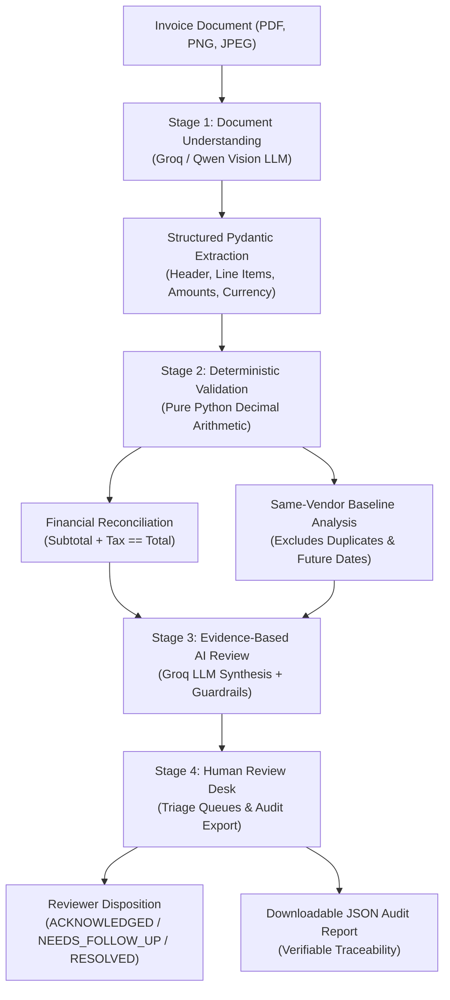

# InVoice AI

**Multi-Stage Invoice Intelligence, Historical Price Analysis & Audit Desk**

InVoice AI is a full-stack invoice intelligence application engineered to evaluate supplier billing accuracy, detect price creep, and support accounts payable workflows. Rather than relying on an autonomous agent to execute unverified actions, InVoice AI operates as a **predictable, multi-stage pipeline**: visual document extraction and LLM review are separated by deterministic financial validation and same-vendor historical price baselines.

---

## The Problem

Accounts payable teams processing recurring supplier invoices face distinct operational challenges:
1. **Unnoticed Price Creep**: Suppliers incrementally raising unit prices on catalog items above established historical baselines.
2. **Mathematical Discrepancies**: Subtle mismatches between line totals, calculated tax, and stated invoice totals.
3. **Duplicate Billing**: Inadvertent re-processing of previously submitted invoice numbers from the same vendor.

InVoice AI automates the detection of arithmetic errors and price variances while keeping human reviewers firmly in control of invoice approval decisions.

---

## The Fixed Multi-Stage Pipeline



### Stage Responsibilities
| Stage | Component | Responsibility |
|---|---|---|
| **1. Document Understanding** | Groq Vision API (`qwen/qwen3.8-27b`) | Extracts vendor, customer, line items, quantities, and totals into an `InvoiceExtractionSchema`. |
| **2. Deterministic Analysis** | Pure Python (`Decimal`) | Validates arithmetic (`Qty * Price == Total`, `Subtotal + Tax == Total`) and builds same-vendor price baselines. |
| **3. Evidence-Based Review** | Groq API (`qwen/qwen3.8-27b`) + Guardrails | Synthesizes verified findings into objective operational explanations without asserting fraud. |
| **4. Human Review Desk** | React 19 UI + FastAPI | Organizes invoices into triage queues, captures human reviewer dispositions, and exports audit records. |

---

## Key Engineering Decisions

* **AI for Perception, Deterministic Code for Math**: LLMs extract visual information and summarize narrative findings, but they never calculate numbers. All arithmetic reconciliation is executed in pure Python using `Decimal` with explicit rounding tolerances (`MONETARY_TOLERANCE = 0.05`).
* **Self-Referential Duplicate Exclusion**: When an invoice number is submitted multiple times, identical prior submissions are excluded from historical baseline pricing to prevent skewing historical averages.
* **Informational Price Decreases**: Vendor price cuts are categorized as informational (`LOW` severity), keeping reviewer attention focused on unapproved price increases.
* **Honest Missing History**: When processing first-time vendors, the system reports `INSUFFICIENT_EVIDENCE` rather than manufacturing speculative price baselines or flagging missing history as suspicious.
* **Zero-Dependency Native Routing**: Frontend navigation between `#upload`, `#review`, and `#invoice-{id}` uses native browser hash history (`window.onhashchange`), providing Back/Forward support without extra router libraries.

---

## Technology Stack

* **Backend**: Python 3.11+, FastAPI, SQLAlchemy 2.0, Alembic, Pydantic v2, PyMuPDF. Detailed schema and endpoint documentation in [`backend/README.md`](backend/README.md).
* **Frontend**: React 19, Vite, Vanilla CSS (custom glassmorphic theme). Component hierarchy and UI workflow in [`frontend/README.md`](frontend/README.md).
* **Database**: PostgreSQL 14+ with relational models and JSON audit fields.
* **AI & Document Understanding**: Groq Cloud SDK (`groq-python`) leveraging vision models.
* **Research Suite**: Candidate benchmarking scripts and exploratory evaluation data in [`backend/evaluation/README.md`](backend/evaluation/README.md).

---

## Local Setup & Quickstart (Windows)

### Prerequisites
* Python 3.11 or 3.12, Node.js 18+, PostgreSQL 14+, and a [Groq API Key](https://console.groq.com/).

### 1. Clone & Configure Database
```powershell
git clone https://github.com/SatwikReddyP08/invoice-ai.git
cd invoice-ai

# In PostgreSQL (psql / pgAdmin):
# CREATE USER invoice_app WITH PASSWORD 'your_password';
# CREATE DATABASE invoice_db OWNER invoice_app;
# GRANT ALL PRIVILEGES ON DATABASE invoice_db TO invoice_app;
```

### 2. Backend Setup
```powershell
cd backend
python -m venv .venv
.\.venv\Scripts\Activate.ps1
python -m pip install --upgrade pip
pip install -r requirements.txt
Copy-Item .env.example .env
# Edit .env: Set POSTGRES_PASSWORD and GROQ_API_KEY
alembic upgrade head
```

### 3. Frontend Setup
In a separate terminal:
```powershell
cd frontend
npm install
```

### 4. Run Development Servers
* **Backend** (from `backend/`):
  ```powershell
  uvicorn app.main:app --reload --port 8000
  ```
  API Docs: `http://localhost:8000/docs`
* **Frontend** (from `frontend/`):
  ```powershell
  npm run dev
  ```
  Application UI: `http://localhost:5173`

---

## Review Workflow & Audit Export

The **Review Desk** categorizes invoices into actionable queues:
* **Needs Attention**: Invoices with arithmetic discrepancies, duplicate submissions, or significant unit-price increases (>10%).
* **Completed Reviews**: Invoices where an authorized reviewer recorded a disposition (`ACKNOWLEDGED`, `NEEDS_FOLLOW_UP`, `RESOLVED`).
* **Informational / Normal**: Invoices mathematically verified with no actionable variances.
* **All Invoices**: Master ledger of all processed documents.

Every processed invoice supports single-click export of a standardized JSON audit record reconciling extracted data, arithmetic validation, historical baseline comparisons, AI findings, and the human disposition. An illustrative synthetic example is provided in [`docs/sample_audit_report.json`](docs/sample_audit_report.json):

```json
{
  "report_title": "InVoice AI Audit & Review Report - #SYNTH-INV-2026-0842 (Synthetic Illustrative Example)",
  "invoice_summary": {
    "invoice_number": "SYNTH-INV-2026-0842",
    "vendor_name": "Northwest Office Solutions LLC (Synthetic)",
    "subtotal": 1200.0,
    "tax_amount": 96.0,
    "total_amount": 1296.0,
    "currency": "USD"
  },
  "financial_validation": { "total_consistent": true, "calculated_total": 1296.0, "difference": 0.0 },
  "historical_price_analysis": {
    "comparisons": [{
      "product": "Ergonomic Lumbar Task Chair",
      "current_unit_price": 450.0,
      "latest_previous_unit_price": 400.0,
      "percentage_change_from_previous": 12.5,
      "change_category": "SIGNIFICANT_INCREASE"
    }]
  },
  "ai_review": {
    "review_recommendation": "REVIEW_RECOMMENDED",
    "findings": [{ "type": "PRICE_CHANGE", "severity": "MEDIUM", "product": "Ergonomic Lumbar Task Chair" }]
  },
  "human_reviewer_disposition": { "disposition": "RESOLVED", "notes": "Verified against contract addendum." }
}
```

---

## Walkthrough Demo Script (45–90 Seconds)

Pre-recorded video files and screenshots are not bundled with this repository. To capture or present a live walkthrough from a local installation, follow this sequence:

| Time | URL / View | Action & Visual Focus | Suggested Narration |
|---|---|---|---|
| **0:00–0:15** | `http://localhost:5173/#upload` | Drop test invoice PDF. Click **Upload**, then **Process Invoice**. | *"InVoice AI evaluates supplier invoices through a predictable 4-stage pipeline combining vision extraction, deterministic math, and AI review."* |
| **0:15–0:35** | `http://localhost:5173/#invoice-1` | View 4-stage status badges, extracted line items, and established tax rate. | *"Groq Vision extracts structured line items, while pure Python Decimal arithmetic independently validates line totals and tax consistency."* |
| **0:35–0:50** | Mid-page scroll | Inspect Historical Price Context and AI Review findings. | *"Identical prior submissions are detected and excluded from baseline pricing; findings clearly explain price increases above threshold."* |
| **0:50–1:15** | Bottom of page | Select **RESOLVED**, enter note *"Verified against contract addendum"*, click **Record Human Disposition**, then **Download Audit Report (JSON)**. | *"Human reviewers retain final authority. Recording a disposition updates the queue and exports a verifiable JSON audit report."* |
| **1:15–1:30** | Top Nav -> Review Desk | Click **Invoice Review Desk**, view **Completed Reviews** tab. | *"The Review Desk organizes invoices into actionable queues: Needs Attention, Completed, and Informational."* |

---

## Limitations & Project Scope

* **Engineering Portfolio Scope**: InVoice AI is a portfolio project and proof-of-concept demonstrating practical AI integration and pipeline architecture. It has not undergone enterprise compliance certification or third-party penetration testing.
* **Human-in-the-Loop Authority**: InVoice AI assists accounts payable review; it does not autonomously authorize disbursements or interface directly with banking networks. Dispositions are recorded with timestamps and reviewer notes, but are not cryptographically immutable.
* **Historical Baseline Requirements**: Price comparisons require prior invoices from the same vendor with matching currency and earlier dates.
* **Input Validation**: Documents are restricted to 10 MB and checked for basic image/PDF magic bytes (`filetype`). Real-world deployments require additional malware scanning and tenant isolation.
* **Evaluation Scope**: Exploratory benchmarks in `backend/evaluation/` reflect a 10-document reference set used to compare model architectures; they are not generalized accuracy guarantees across arbitrary global invoice formats.
